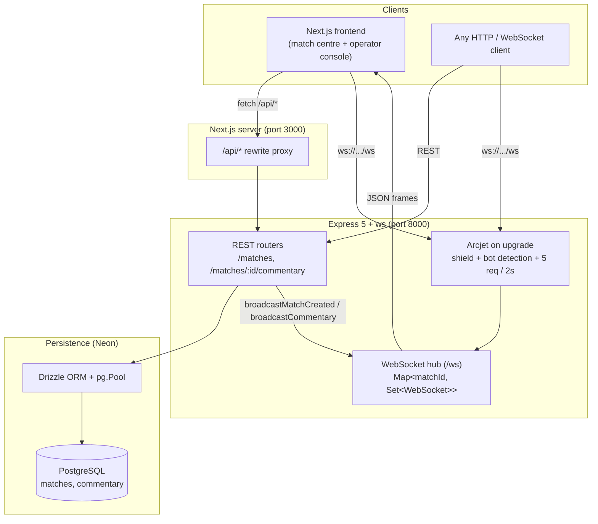
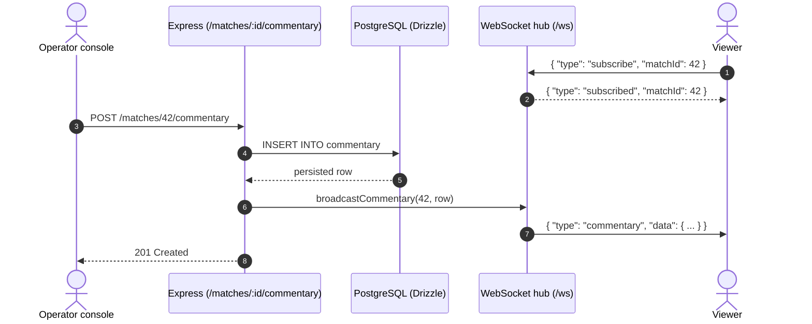

# Sportz: Real-Time Match Commentary & Live Scores

[](https://nodejs.org/)
[](https://expressjs.com/)
[](https://github.com/websockets/ws)
[](https://orm.drizzle.team/)
[](https://neon.tech/)
[](https://zod.dev/)
[](https://arcjet.com/)
[](https://nextjs.org/)
[](https://react.dev/)
[](https://tailwindcss.com/)

Sportz is a real-time sports platform that pushes live match commentary and new fixtures to every connected viewer the moment they are published.

- **Backend:** an Express 5 REST API and a `ws` WebSocket server sharing one HTTP server, with topic-based pub/sub per match, Drizzle ORM on PostgreSQL (Neon), Zod validation and Arcjet protection on WebSocket upgrades.
- **Frontend:** a Next.js 16 match centre (React 19, Tailwind CSS 4, TypeScript) with live scoreboards, a play-by-play commentary feed and an operator console for publishing events.

---

## Table of Contents

- [Architecture](#architecture)
- [Features](#features)
- [Tech Stack](#tech-stack)
- [Project Structure](#project-structure)
- [Getting Started](#getting-started)
- [Environment Variables](#environment-variables)
- [REST API Reference](#rest-api-reference)
- [WebSocket Protocol](#websocket-protocol)
- [Security (Arcjet)](#security-arcjet)
- [Connection Handling](#connection-handling)
- [Smoke Test](#smoke-test)
- [Roadmap](#roadmap)
- [License](#license)

---

## Architecture



### Broadcast flow



---

## Features

**Backend**

- **Per-match channels:** clients subscribe to a `matchId` and only receive commentary for the matches they follow.
- **Global fixture broadcast:** every new match is pushed to all open connections as a `match_created` frame.
- **Typed schema:** Drizzle ORM tables for `matches` and `commentary`, a `match_status` enum (`scheduled`, `live`, `finished`), plus JSONB `metadata` and `text[]` `tags` on commentary.
- **Time-based status:** a match's status is computed from `startTime` / `endTime` when it is created ([`match-status.js`](backend/src/utils/match-status.js)).
- **Validation:** Zod schemas for route params, query strings and request bodies, returning `400` with field-level `details`. `endTime` must be after `startTime`.
- **Abuse protection:** Arcjet shield, bot detection and a sliding-window rate limit on WebSocket upgrades.
- **Leak-free sockets:** 30s ping/pong heartbeat, subscription cleanup on close and a 1 MB max payload.

**Frontend**

| Route | What it does |
|---|---|
| `/` | Match centre with Live now / Upcoming / Results sections, status counts, sport filter and search. New fixtures appear instantly with a toast. |
| `/matches/[id]` | Scoreboard with a live match clock and key-moment timeline, real-time commentary feed (all events or key moments) and per-team event stats. |
| `/console` | Operator console: create matches with quick-schedule presets (now, in 30 min, tomorrow) and publish commentary using one-click event presets (goal, card, VAR, substitution, and more). |

- One shared WebSocket connection ([`realtime-provider.tsx`](frontend/src/components/realtime-provider.tsx)) with exponential backoff and jitter, ref-counted subscriptions that are restored after a reconnect, and instant reconnect when the tab or network comes back.
- REST calls go through a Next.js `/api/*` rewrite to the backend, so the browser stays same-origin and the API needs no CORS setup.
- Match status is re-derived on the client from `startTime` / `endTime` (same rules as the backend), because the stored `status` is only set at creation.
- Sport-agnostic event styling: football, cricket, basketball, rugby and more, with aliases like `ht`, `ft`, `sub`, `four`, `six` ([`events.ts`](frontend/src/lib/events.ts)).

---

## Tech Stack

| Layer | Technology |
|---|---|
| Runtime | Node.js (ES modules) |
| API | Express 5 |
| Real-time | `ws` 8 |
| Database | PostgreSQL on Neon, `pg` connection pool |
| ORM & migrations | Drizzle ORM + Drizzle Kit |
| Validation | Zod 4 |
| Security | Arcjet (`@arcjet/node`) |
| Frontend | Next.js 16 (App Router), React 19, TypeScript |
| Styling & UI | Tailwind CSS 4, lucide-react icons, sonner toasts |

---

## Project Structure

```text
sportz-websockets/
├── backend/                       # Express API + WebSocket server
│   ├── src/
│   │   ├── index.js               # Entry point: HTTP server, routers, WebSocket bootstrap
│   │   ├── arcjet.js              # Arcjet clients (HTTP + WS) and Express middleware
│   │   ├── db/
│   │   │   ├── db.js              # pg Pool + Drizzle instance
│   │   │   └── schema.js          # matches, commentary tables and match_status enum
│   │   ├── routes/
│   │   │   ├── matches.js         # GET / POST /matches
│   │   │   └── commentary.js      # GET / POST /matches/:id/commentary
│   │   ├── utils/
│   │   │   └── match-status.js    # Status from start/end time
│   │   ├── validation/
│   │   │   ├── matches.js         # Zod schemas for matches
│   │   │   └── commentary.js      # Zod schemas for commentary
│   │   └── ws/
│   │       └── server.js          # WebSocket hub: pub/sub, heartbeat, Arcjet upgrade check
│   ├── drizzle/                   # Generated SQL migrations
│   ├── drizzle.config.js
│   ├── package.json
│   └── .env.example
├── frontend/                      # Next.js match centre
│   ├── src/
│   │   ├── app/                   # Routes: /, /matches/[id], /console
│   │   ├── components/            # Dashboard, match centre, console, realtime provider, UI
│   │   ├── hooks/                 # useMatches, useCommentary, useNow
│   │   └── lib/                   # API client, types, match helpers, event styles
│   ├── next.config.ts             # /api/* rewrite to the backend
│   ├── package.json
│   └── .env.example
└── README.md
```

---

## Getting Started

### Prerequisites

- Node.js 20.9 or newer (required by Next.js 16)
- A PostgreSQL database (a free [Neon](https://neon.tech/) project works)
- An [Arcjet](https://app.arcjet.com) API key (the backend will not start without one)

### 1. Backend

```bash
cd backend
cp .env.example .env        # then fill in DATABASE_URL and ARCJET_KEY
npm install

npm run db:generate         # generate SQL from src/db/schema.js
npm run db:migrate          # apply migrations to the database
npm run db:studio           # optional: browse tables in Drizzle Studio

npm run dev                 # starts with node --watch
```

```text
Server is running on http://localhost:8000
WebSocket server is running on ws://localhost:8000/ws
```

### 2. Frontend

In a second terminal, with the backend running:

```bash
cd frontend
cp .env.example .env.local  # optional, defaults point at localhost:8000
npm install
npm run dev
```

Open [http://localhost:3000](http://localhost:3000), create a match from `/console`, then open it in another tab to watch commentary arrive live.

---

## Environment Variables

### `backend/.env`

| Variable | Required | Default | Description |
|---|---|---|---|
| `DATABASE_URL` | Yes | | PostgreSQL connection string (Neon: Project > Dashboard > Connect). |
| `ARCJET_KEY` | Yes | | Arcjet API key. The server throws on startup if it is missing. |
| `ARCJET_MODE` | No | `LIVE` | `LIVE` blocks requests, `DRY_RUN` only logs decisions. |
| `ARCJET_ENV` | No | | Set to `development` locally so Arcjet allows localhost and private IPs. Remove in production. |
| `PORT` | No | `8000` | HTTP and WebSocket port. Leave unset on hosts that inject it (Render, Railway, Fly.io). |
| `HOST` | No | `0.0.0.0` | Bind address. |

### `frontend/.env.local`

| Variable | Default | Description |
|---|---|---|
| `BACKEND_URL` | `http://localhost:8000` | Express API that `/api/*` is proxied to (server-side only). |
| `NEXT_PUBLIC_WS_URL` | `ws://localhost:8000/ws` | WebSocket endpoint the browser connects to. |

---

## REST API Reference

All successful responses are wrapped in `{ "data": ... }`. Validation errors return `400` with `{ "error": "...", "details": [ ...zod issues ] }`.

### `GET /matches`

Most recently created matches first.

| Query | Type | Default | Max |
|---|---|---|---|
| `limit` | integer | 50 | 100 |

```json
{
  "data": [
    {
      "id": 1,
      "sport": "Football",
      "homeTeam": "Arsenal",
      "awayTeam": "Chelsea",
      "status": "live",
      "startTime": "2026-09-16T10:00:00.000Z",
      "endTime": "2026-09-16T12:00:00.000Z",
      "homeScore": 1,
      "awayScore": 0,
      "createdAt": "2026-09-16T09:30:00.000Z"
    }
  ]
}
```

### `POST /matches`

Creates a match, sets its status from the start/end time and broadcasts `match_created` to every connected client. Returns `201` with the created row.

```json
{
  "sport": "Football",
  "homeTeam": "Arsenal",
  "awayTeam": "Chelsea",
  "startTime": "2026-09-16T10:00:00.000Z",
  "endTime": "2026-09-16T12:00:00.000Z",
  "homeScore": 0,
  "awayScore": 0
}
```

`sport`, `homeTeam`, `awayTeam`, `startTime` and `endTime` (ISO 8601) are required. Scores default to `0`.

### `GET /matches/:id/commentary`

Commentary for one match, newest first.

| Query | Type | Default | Max |
|---|---|---|---|
| `limit` | integer | 10 | 100 |

```json
{
  "data": [
    {
      "id": 101,
      "matchId": 1,
      "minute": 15,
      "sequence": 1,
      "period": "1st Half",
      "eventType": "goal",
      "actor": "Bukayo Saka",
      "team": "Arsenal",
      "message": "Goal! Curling shot into the top corner.",
      "metadata": null,
      "tags": null,
      "createdAt": "2026-09-16T10:15:00.000Z"
    }
  ]
}
```

### `POST /matches/:id/commentary`

Stores a commentary event and broadcasts it to clients subscribed to that match. Returns `201` with the stored row.

```json
{
  "minute": 15,
  "sequence": 1,
  "period": "1st Half",
  "eventType": "goal",
  "actor": "Bukayo Saka",
  "team": "Arsenal",
  "message": "Goal! Curling shot into the top corner.",
  "metadata": { "assist": "Martin Odegaard" },
  "tags": ["highlight"]
}
```

`minute` (non-negative integer) and `message` are required. Everything else is optional.

---

## WebSocket Protocol

Endpoint: `ws://localhost:8000/ws`

On connect the server sends:

```json
{ "type": "welcome" }
```

### Client to server

| Message | Server reply |
|---|---|
| `{ "type": "subscribe", "matchId": 1 }` | `{ "type": "subscribed", "matchId": 1 }` |
| `{ "type": "unsubscribe", "matchId": 1 }` | `{ "type": "unsubscribed", "matchId": 1 }` |
| Anything that is not valid JSON | `{ "type": "error", "message": "Invalid JSON" }` |

`matchId` must be an integer. Other message types are ignored.

### Server to client

| Frame | Sent to | When |
|---|---|---|
| `{ "type": "match_created", "data": Match }` | All connected clients | After `POST /matches` |
| `{ "type": "commentary", "data": Commentary }` | Subscribers of `data.matchId` | After `POST /matches/:id/commentary` |

`data` is the full database row, in the same shape as the REST responses.

---

## Security (Arcjet)

Rules live in [`backend/src/arcjet.js`](backend/src/arcjet.js) and run in `LIVE` or `DRY_RUN` mode via `ARCJET_MODE`.

**WebSocket upgrades (active)**

Every `upgrade` request to `/ws` is checked before the handshake completes:

- `shield`: blocks common attack patterns
- `detectBot`: blocks automated clients, except search engines and link previews
- `slidingWindow`: 5 upgrades per 2 seconds per client

Denied requests get `429 Too Many Requests` (rate limit) or `403 Forbidden`, and the socket is destroyed.

> Because of `detectBot`, headless browsers and scripted clients (for example a `HeadlessChrome` user agent) cannot open a live connection. Use a regular browser, or `ARCJET_MODE=DRY_RUN` while testing.

**HTTP routes (available, not enabled)**

`securityMiddleware()` applies `shield`, `detectBot` and a 50 requests / 10 seconds sliding window to REST routes. It is currently commented out in [`backend/src/index.js`](backend/src/index.js). To enable it, uncomment:

```js
app.use(securityMiddleware());
```

---

## Connection Handling

1. **O(1) fan-out:** subscriptions are stored in a `Map<matchId, Set<WebSocket>>`, so a commentary broadcast only touches sockets subscribed to that match. Each frame is serialised once per broadcast.
2. **Heartbeat:** every 30 seconds the server pings each client and terminates any socket that did not answer the previous ping.
3. **Cleanup on close:** each socket tracks its own subscriptions, and on close it is removed from every match set. Empty sets are deleted.
4. **Payload limit:** incoming messages are capped at 1 MB.
5. **Connection pooling:** REST queries share a `pg.Pool`.

These are design choices; the server has not been load tested yet.

---

## Smoke Test

```javascript
// smoke-test.mjs  (run from backend/ so the ws package resolves)
import WebSocket from 'ws';

const ws = new WebSocket('ws://localhost:8000/ws');

ws.on('open', () => ws.send(JSON.stringify({ type: 'subscribe', matchId: 1 })));

ws.on('message', (raw) => {
  const message = JSON.parse(raw.toString());
  console.log('Received:', message);

  if (message.type === 'subscribed') {
    console.log('Smoke test passed.');
    ws.close();
  }
});

ws.on('error', (err) => {
  console.error('Smoke test failed:', err.message);
  process.exit(1);
});
```

```bash
node smoke-test.mjs
```

> With `ARCJET_MODE=LIVE`, Arcjet may treat this script as a bot and reject the upgrade with `403`. Run the backend with `ARCJET_MODE=DRY_RUN` for scripted tests.

---

## Roadmap

- Enable Arcjet on the REST routes
- Score update endpoint (an `updateScoreSchema` already exists) with a live score broadcast
- Single-match endpoint (`GET /matches/:id`); the frontend currently finds a match in `GET /matches?limit=100`
- Periodic status sync so stored `status` follows the clock
- Redis pub/sub so multiple backend instances can share match channels

---

## License

ISC, as declared in [`backend/package.json`](backend/package.json).
